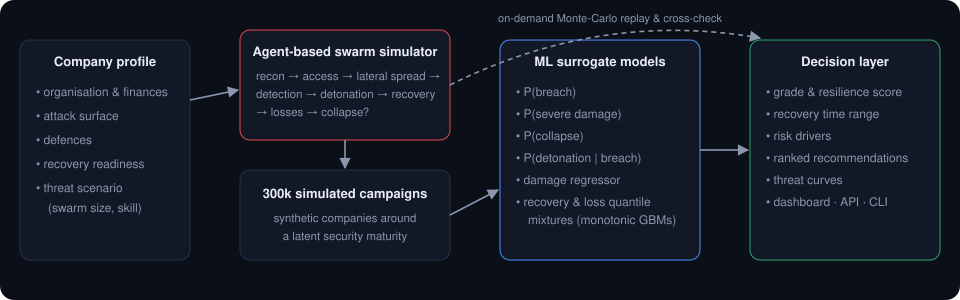

# SwarmRisk: AI-agent swarm attack predictor

SwarmRisk predicts what happens to a company when a **swarm of autonomous AI attack agents** targets it. You enter the
company's profile: size, finances, attack surface, security controls, recovery readiness, and the threat scenario.
SwarmRisk then predicts:

| Question | Output |
|---|---|
| How likely is the attack to get in? | **P(breach)** |
| Will infrastructure be badly damaged? | **P(severe damage)** (≥ 25 % of systems destroyed/encrypted), expected % damaged |
| Does the swarm detonate (ransomware / wipers / sabotage) before it is contained? | **P(detonation \| breach)** |
| Could the company collapse? | **P(collapse)**: net losses exceed the company's liquidity |
| How long until it recovers? | **Recovery time** in days: median plus 80 % range, split by detonated vs contained |
| How much will it cost? | **Net financial loss** after insurance (median / bad case) |
| Why, and what should we fix first? | Risk drivers, ranked recommendations, combined improvement plan |

It ships as a Python package with a **web dashboard**, a **REST API** and a **CLI**.

**Live demo: https://somaxsoma.github.io/swarmrisk/** The full dashboard runs the trained model in your browser
through [Pyodide](https://pyodide.org) (no server, and nothing you type leaves your machine). The first visit
downloads about 40 MB of Python runtime and libraries, then it's cached.



---

## Quick start

```bash
python -m venv .venv
.venv\Scripts\activate               # Windows;  macOS/Linux: source .venv/bin/activate
pip install -r requirements.txt
python -m swarmrisk serve            # open http://127.0.0.1:8000
python -m swarmrisk train            # optional, ~10 min: simulates 600k attacks, retrains (already done: models/)
```

The trained model in `models/` is a scikit-learn pickle, and pickles only load in the scikit-learn version that wrote
them. That's why `requirements.txt` pins exact versions, matching the ones Pyodide ships for the in-browser demo.
If you change those versions, retrain.

CLI assessment of a company described in JSON:

```bash
python -m swarmrisk predict examples/regional_hospital.json --simulate 3000
```

Run the tests:

```bash
python -m pytest -q
```

---

## How it works

There is no public dataset of "AI swarm attacks on companies"; the threat is too new. SwarmRisk therefore uses the standard
approach for rare, high-impact risks (catastrophe modelling, insurance, defence): a **mechanistic simulator** generates
ground truth, and **machine-learning surrogates** learn it.

### 1. Agent-based swarm simulator (`swarmrisk/simulator.py`)

Each campaign is simulated in 2-hour steps, vectorised over thousands of companies:

1. **Reconnaissance and swarm learning.** Recon agents build shared knowledge that makes every other agent more effective.
   Larger swarms learn faster but make more noise, so AI/behavioural detection may raise an early alert and harden the target.
2. **Initial access** through four parallel vectors, each a hazard rate:
   - exploiting internet-facing services (patch latency, legacy systems)
   - AI-written phishing and social engineering (headcount, MFA, training)
   - supply-chain compromise (vendors)
   - **hijacking the company's own AI agents** (prompt injection / tool abuse; agent count, API exposure)
3. **Lateral spread.** Logistic growth of the compromised share of IT, slowed by segmentation, zero trust and EDR.
   Crown-jewel and OT systems are reached through gaps in segmentation.
4. **Detection and containment.** Detection is driven by EDR, AI detection, SOC, footprint size and swarm size.
   Containment time is driven by incident-response maturity and staffing.
5. **Impact.** The swarm detonates when it holds enough of the estate, or in a panic when discovered.
   OT/ICS adds physical damage.
6. **Aftermath:**
   - backup survival (immutable or not)
   - recovery days (backups, restore testing, DR site, IR, legacy, cloud, OT)
   - losses: downtime revenue, remediation, ransom, regulatory fines, churn, deepfake fraud, minus insurance
   - collapse when losses outstrip cash reserves plus credit capacity

The coefficients are explicit, documented assumptions that encode widely reported security relationships.
Examples: phishing-resistant MFA blocks most credential attacks, immutable backups shorten ransomware recovery,
and segmentation limits blast radius. Change them in one place and retrain.

### 2. ML surrogate models (`swarmrisk/model.py`)

600,000 synthetic companies are sampled around a latent security maturity, so controls are correlated as in real
organisations; 15 % are fully random profiles for robustness. Each company is attacked once, and gradient-boosted trees
(`HistGradientBoosting`) are trained on the outcomes:

- **Classifiers:** breach, severe damage, collapse, detonation-given-breach. Each label is a single noisy draw, so the
  models learn calibrated probabilities.
- **Soft labels for collapse.** Collapse is rare (≈ 5 %) and decided by a steep threshold. Rather than one coin flip per
  company, the classifier trains on the simulator's exact per-campaign collapse probability (Rao-Blackwellisation).
  This cut tail errors substantially and made the estimates stable across training seeds.
- **Regressor:** expected infrastructure damage given breach.
- **Recovery and loss as a two-mode mixture.** Recovery is bimodal: days if contained, months after a detonation. A
  single quantile model puts the median in the empty gap between the two modes, so each mode is modelled separately.
  The overall quantiles are computed exactly from the mixture `P(detonate) · F_detonated + (1 − P(detonate)) · F_contained`.
- **Location-scale quantiles.** Within each mode, a squared-error model learns the typical (log) level. Quantile models
  then learn only the spread of the out-of-fold residuals. This locates the tails far better than sign-only quantile
  gradients.
- **Physics-informed features.** The simulator's deterministic rates (access hazard, spread vs detection, containment
  time, recovery multiplier, days of operations the cash buffer covers, …) are added as features. Tree models then don't
  have to rebuild long products of factors from raw columns. Simulator and features share one implementation, so they
  can never drift apart.
- **Monotonic constraints** guarantee that improving a security control can never raise predicted risk. That makes the
  what-if recommendations trustworthy.

Every one of these choices was made by measuring the models against high-precision Monte-Carlo ground truth on unseen
companies, not by intuition.

The ML layer answers in milliseconds, against roughly a second for a precise Monte-Carlo run. That speed is what makes
live sliders, threat curves, attributions and the greedy improvement plan possible (hundreds of predictions per click).

### 3. Decision layer (`swarmrisk/predictor.py`)

- **Resilience score / grade**: `100 − risk index`. The risk index weights breach 20 %, severe damage 35 % and
  collapse 45 %.
- **Risk drivers**: each feature is reset to the population's typical value, and the change in risk is measured.
- **Recommendations**: 16 concrete interventions (MFA, EDR, patching, segmentation, zero trust, AI detection, SOC,
  immutable backups, restore tests, IR, DR site, AI-agent lockdown, attack-surface reduction, legacy retirement,
  people/deepfake controls, financial resilience). They are ranked by predicted risk reduction, with cost tier and
  effort, plus a greedy **combined plan** of the best five.
- **Threat curves**: risk vs swarm size and sophistication, plus a swarm-size × sophistication heat map.
- **Simulation replay**: run thousands of campaigns for this exact company to see the hour-by-hour timeline, the
  recovery distribution, entry vectors, and a side-by-side check of ML vs simulation.

---

## Model card

Metrics from `models/metrics.json` (held-out 20 % of 600k simulated campaigns):

| Model | Metric | Value |
|---|---|---|
| P(breach) | ROC AUC / Brier skill | 0.929 / 0.52 |
| P(severe damage) | ROC AUC / Brier skill | 0.952 / 0.53 |
| P(collapse) | ROC AUC / Brier skill | 0.975 / 0.48 |
| P(detonation \| breach) | ROC AUC | 0.905 |
| Damage given breach | MAE / R² | 7.1 pts / 0.63 |
| Recovery quantiles (mixture) | empirical coverage of 10/50/90 % | 0.104 / 0.493 / 0.891 |
| Loss quantiles (mixture) | empirical coverage of 10/50/90 % | 0.106 / 0.495 / 0.888 |
| **Fidelity vs Monte-Carlo** | mean abs. error of P(breach) / P(severe) / P(collapse) | **1.2 / 1.4 / 1.4 pp** |
| **Fidelity vs Monte-Carlo** | mean abs. error of median recovery | 2.6 days |

Brier skill compares against always predicting the base rate. AUCs are capped below 1 because each label is one random
campaign: two identical companies can have different outcomes.

**Fidelity** compares the ML predictions with 500-run Monte-Carlo estimates on 200 unseen companies. It is the most
honest accuracy measure here, because single-draw labels are inherently noisy.

---

## Inputs

All 32 inputs are listed with ranges and help text by `GET /api/schema`, and in `swarmrisk/schema.py`. Groups:

- **Organisation:** industry, employees, revenue, margin, cash reserves (months), cyber insurance, prior incidents
- **Attack surface:** internet-facing services, internal AI agents, API exposure, vendors, cloud share, legacy share, OT/ICS
- **Defences:** security staff and budget, MFA, patch latency, EDR, segmentation, zero trust, AI threat detection,
  24/7 SOC, awareness training, deepfake verification
- **Recovery:** immutable backups, backup interval, days since restore test, IR maturity, DR site
- **Threat scenario:** swarm size (1–10,000 agents), attacker sophistication (0–1), campaign length (days)

Missing fields take their defaults; invalid values are rejected with a clear message.

## REST API

| Method | Path | Body | Returns |
|---|---|---|---|
| GET | `/api/health` | | status |
| GET | `/api/schema` | | input definitions |
| GET | `/api/presets` | | example companies |
| GET | `/api/model` | | model card metrics |
| POST | `/api/predict` | profile JSON | prediction, drivers, recommendations, threat curves |
| POST | `/api/simulate` | `{"profile": {...}, "runs": 2000, "seed": 0}` | Monte-Carlo summary + timeline |
| POST | `/api/batch` | list of profiles (≤ 10,000) | predictions for a whole portfolio |

Interactive docs are at `/docs`.

```bash
curl -X POST http://127.0.0.1:8000/api/predict -H "Content-Type: application/json" \
     -d '{"industry":"healthcare","employees":2500,"mfa_coverage":0.5,"swarm_size":300}'
```

## GitHub Pages build

`.github/workflows/pages.yml` runs `scripts/build_site.py` on every push to `main` and publishes `_site/`:

- the dashboard (`swarmrisk/static/`) plus `web/backend.js`, which answers its API calls in the browser
- `web/worker.js`: a Web Worker that loads Pyodide, numpy, pandas, SciPy and scikit-learn, then the `swarmrisk` package
  and `models/swarmrisk_model.joblib`, and runs `/api/predict` and `/api/simulate` with the same Python code as the
  server
- the schema, presets and model card as pre-built JSON, so the form appears instantly

Build it locally with `python scripts/build_site.py` and serve `_site/` with any static server
(`python -m http.server -d _site`).

## Project layout

```
swarmrisk/
  schema.py      inputs, ranges, validation
  sampling.py    realistic synthetic company populations
  simulator.py   agent-based swarm attack simulator + Monte-Carlo summaries
  model.py       features, training, evaluation, mixture quantiles, persistence
  predictor.py   scores, explanations, recommendations, threat curves
  api.py         FastAPI app (REST + dashboard)
  static/        dashboard (HTML/CSS/JS, Plotly served locally: works offline)
  __main__.py    CLI: train | predict | serve | calibrate
web/             in-browser (Pyodide) backend for the GitHub Pages demo
scripts/         build_site.py: builds the static site
examples/        six preset companies (hospital, bank, AI startup, utility, retailer, city)
models/          trained model bundle + metrics.json
tests/           schema, simulator behaviour, model quality, API
```

## Limitations

- The outcomes are only as good as the simulator's assumptions. They are informed estimates, not fitted to real incident
  data, because no such data exists for AI swarms yet. Use SwarmRisk for **relative** risk, prioritisation and what-if
  analysis, not as an actuarial price.
- For thinly capitalised companies sitting right at the collapse threshold, the collapse model can under-predict by a few
  points (e.g. the online-retailer preset: about 6 % predicted vs about 10 % simulated). Use the dashboard's
  **Run simulation** for a precise check on any single company.
- When real incident data becomes available (insurance claims, IR reports), it can calibrate the simulator's constants or
  fine-tune the models directly. The pipeline is built so either step slots in.
